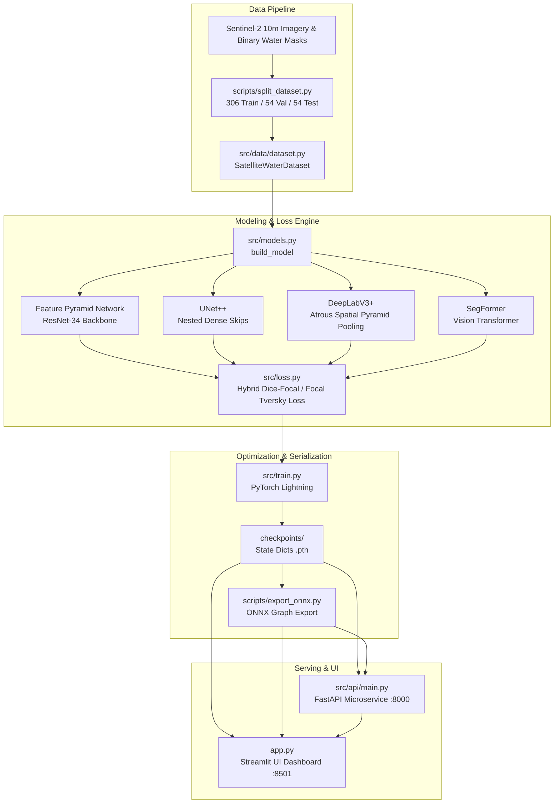
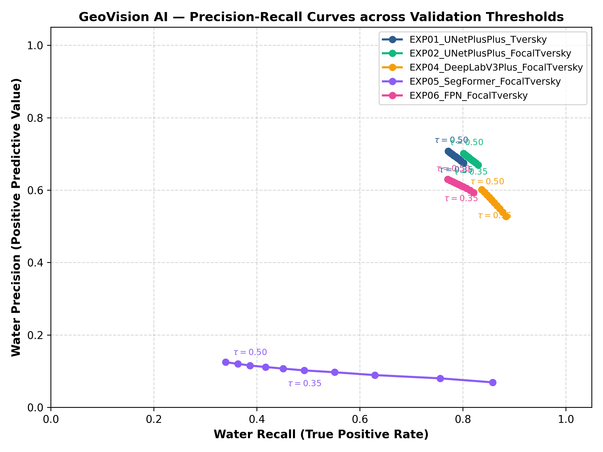
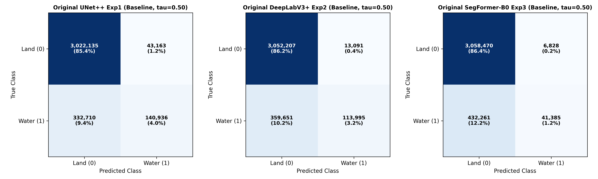
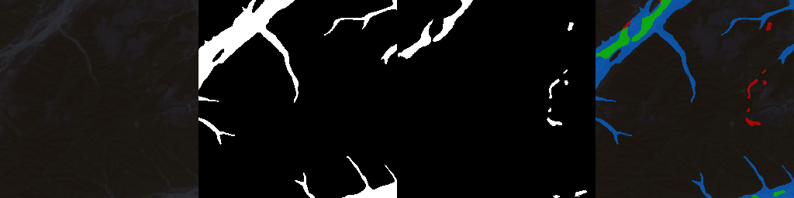

# GeoVision AI — Satellite Water Body Segmentation Platform

A modular computer vision platform for high-resolution surface water detection, segmentation, and hydrological surface area quantification from optical satellite imagery (Sentinel-2).

---

## 1. Problem Statement

Automated water body detection from optical remote sensing imagery is a critical capability for flood monitoring, reservoir storage tracking, and drought assessment. However, applying standard deep learning segmentation models directly to satellite tiles reveals fundamental technical challenges:

1. **Extreme Class Imbalance**: In optical satellite imagery, land dominates over water. In our Sentinel-2 dataset, water covers only **4.22%** of all pixels across the dataset (a **24.7:1 land-to-water ratio**).
2. **The Accuracy Paradox**: Under severe imbalance, a trivial classifier predicting all background achieves **86.6% to 89.5% pixel accuracy** while capturing **0% to 24% of actual water bodies**, completely failing as a detection system.
3. **Fine-Boundary & Thin-Stream Degradation**: Standard segmentation decoders (such as ASPP in DeepLabV3+ or downsampled Transformer patches in SegFormer) lose narrow river tributaries and coastal boundaries through successive spatial pooling.

GeoVision AI evaluates multi-architecture segmentation models (**Feature Pyramid Networks (FPN)**, **UNet++**, **DeepLabV3+**, **SegFormer**), diagnoses systematic false negatives, and implements asymmetric recall-prioritized loss functions (**Tversky Loss** and **Focal Tversky Loss**) to achieve balanced precision and recall.

---

## 2. System Architecture



---

## 3. Verified Benchmark Results

All models were evaluated on the identical **54 held-out test patches** ($256 \times 256$, totaling **3,538,944 test pixels** containing 473,646 ground-truth water pixels and 3,065,298 land pixels). Evaluations were executed deterministically at threshold $\tau = 0.50$ (with validation-calibrated $\tau^* = 0.60$ for improved models).

| Model Architecture & Experiment | Model Class | Decision Threshold ($\tau$) | Pixel Accuracy (%) | Water Precision (%) | Water Recall (%) | Macro Dice | Macro IoU | Micro Dice | Micro IoU | True Positives (TP) | False Positives (FP) | False Negatives (FN) | True Negatives (TN) |
| :--- | :--- | :---: | :---: | :---: | :---: | :---: | :---: | :---: | :---: | :---: | :---: | :---: | :---: |
| **UNet++ (Exp1 Baseline)** | Baseline | 0.50 | 89.38% | 76.55% | 29.76% | 0.3032 | 0.2035 | 0.4285 | 0.2727 | 140,936 | 43,163 | 332,710 | 3,022,135 |
| **DeepLabV3+ (Exp2 Baseline)** | Baseline | 0.50 | 89.47% | 89.70% | 24.07% | 0.2211 | 0.1464 | 0.3795 | 0.2342 | 113,995 | 13,091 | 359,651 | 3,052,207 |
| **SegFormer-B0 (Exp3 Baseline)** | Baseline | 0.50 | 87.59% | 85.84% | 8.74% | 0.1083 | 0.0615 | 0.1586 | 0.0861 | 41,385 | 6,828 | 432,261 | 3,058,470 |
| **Improved UNet++ (EXP01 Tversky)** | Improved | 0.50 | 90.64% | 80.37% | 39.75% | 0.3872 | 0.2718 | 0.5319 | 0.3623 | 188,256 | 45,992 | 285,390 | 3,019,306 |
| **Improved DeepLabV3+ (EXP04 Focal Tversky)** | Improved | 0.50 | 90.22% | 78.57% | 37.05% | 0.3636 | 0.2542 | 0.5036 | 0.3365 | 175,501 | 47,872 | 298,145 | 3,017,426 |
| **Improved SegFormer-B0 (EXP05 Focal Tversky)** | Improved | 0.50 | 87.03% | 52.51% | 32.75% | 0.3414 | 0.2275 | 0.4034 | 0.2527 | 155,141 | 140,320 | 318,505 | 2,924,978 |
| **Improved FPN (EXP06 Focal Tversky) — CHAMPION** | **Champion** | **0.50** | **91.56%** | **75.81%** | **54.24%** | **0.4580** | **0.3328** | **0.6323** | **0.4624** | **256,886** | **81,954** | **216,760** | **2,983,344** |
| **Improved FPN (EXP06 Calibrated)** | Calibrated | 0.60 | 91.56% | 76.45% | 53.35% | 0.4544 | 0.3295 | 0.6284 | 0.4582 | 252,677 | 77,835 | 220,969 | 2,987,463 |

> [!NOTE]
> Detailed per-image breakdown, statistical distributions, and metric definitions are documented in [`reports/model-evaluation.md`](file:///Users/safalyareddy/Desktop/Projects/GeoVision-AI-Satellite-Water-Body-Segmentation-Platform/reports/model-evaluation.md) and [`reports/benchmark-results.csv`](file:///Users/safalyareddy/Desktop/Projects/GeoVision-AI-Satellite-Water-Body-Segmentation-Platform/reports/benchmark-results.csv).

---

## 4. Visual Evidence & Diagnostics

### Precision-Recall Curves
Precision-recall dynamics across decision thresholds ($0.10 \le \tau \le 0.90$). The champion FPN model maintains superior recall without steep precision degradation:



### Normalized Confusion Matrices
Pixel-level confusion matrices demonstrating the progressive reduction of false negative water pixels:



### Segmentation Sample (Patch 0010 — Inland Lake & Estuary)
Sample prediction illustrating high-fidelity shoreline extraction:



---

## 5. Technology Stack

- **Machine Learning**: PyTorch 2.x, PyTorch Lightning, Segmentation Models PyTorch (SMP), Transformers (Hugging Face).
- **Optimization & Export**: ONNX Runtime (CPU execution provider, Opset 17).
- **Inference & Serving API**: FastAPI, Uvicorn, Pydantic, HTTPX.
- **Frontend Dashboard**: Streamlit, PIL, Matplotlib.
- **Testing & Code Quality**: Pytest (45 unit and integration tests), pre-commit hooks.
- **Containerization & CI**: Docker, Docker Compose, GitHub Actions.

---

## 6. Installation & Quickstart

### Prerequisites
- Python 3.10 or 3.11
- Git

### Local Setup
```bash
# 1. Clone the repository
git clone https://github.com/safalyareddy/GEOVISION_AI.git
cd GEOVISION_AI

# 2. Create and activate a virtual environment
python3 -m venv venv
source venv/bin/activate

# 3. Install CPU PyTorch wheels and dependencies
pip install --upgrade pip
pip install torch torchvision --index-url https://download.pytorch.org/whl/cpu
pip install -r requirements.txt

# 4. Run the full automated test suite
PYTHONPATH=. pytest tests/ -v
```

---

## 7. Execution

### 1. Launch FastAPI Microservice
```bash
uvicorn src.api.main:app --host 0.0.0.0 --port 8000 --reload
```
Interactive API documentation:
- Swagger UI: `http://localhost:8000/docs`
- ReDoc: `http://localhost:8000/redoc`

Test health endpoint:
```bash
curl http://localhost:8000/health
```

Run test inference via curl:
```bash
curl -X POST "http://localhost:8000/predict" \
     -F "file=@dataset/test/images/patch_0047.png" \
     -F "model_name=fpn" \
     -F "threshold=0.5"
```

### 2. Launch Streamlit Interactive Dashboard
```bash
streamlit run app.py --server.port 8501
```
Navigate to `http://localhost:8501` to upload satellite tiles, toggle architectures, tune the decision threshold slider, and compare model outputs.

---

## 8. Docker Deployment

### Run with Docker
```bash
# Build unified container
docker build -t geovision-ai:latest .

# Run FastAPI service
docker run -p 8000:8000 geovision-ai:latest
```

### Run Multi-Container Stack (API + UI)
```bash
docker compose up -d --build
```
- API accessible at `http://localhost:8000`
- UI accessible at `http://localhost:8501`

---

## 9. Model Checkpoints & Acquisition

Model weights are saved as PyTorch state dictionaries (`.pth`). Checkpoint checksums and architectures are listed below:

| Architecture | Experiment ID | Checkpoint File | Size | SHA-256 Checksum |
| :--- | :--- | :--- | :---: | :--- |
| **FPN (Champion)** | EXP06 | `EXP06_FPN_FocalTversky_best.pth` | 88.5 MB | `d21fa18c36beabdb0b139364d347a6e97c1cc00e83e9ba92630e9a7795119eb1` |
| **UNet++ (Improved)** | EXP01 | `EXP01_UNetPlusPlus_Tversky_best.pth` | 99.7 MB | `497e246ef79d87f3b2255cc119e7ab8bd0045d48caf3d4710e9f6738e56c4548` |
| **DeepLabV3+ (Improved)** | EXP04 | `EXP04_DeepLabV3Plus_FocalTversky_best.pth` | 85.8 MB | `6c7c6dd4835d29be34b9eda03bdfca878914749a526c44cade99906cc1b1b827` |
| **UNet++ (Baseline)** | Baseline | `unet_plusplus_best.pth` | 99.7 MB | `e9ac1bed148e6f3e8926d9008fd3fe6ad490ff8ed1dee6d79b96134ef8712c9b` |

To obtain trained model weights:
```bash
# Weights can be downloaded from the release tag or Hugging Face model repository
# Place the .pth files into the checkpoints/ directory
mkdir -p checkpoints
```

---

## 10. Limitations & Engineering Scope

1. **Geographic Distribution**: The benchmark dataset consists of regional Sentinel-2 optical scenes. Performance may vary across unseen geographic domains (e.g., glacial regions, arid salinas, heavy shadow). Universal generalization is not claimed without regional fine-tuning.
2. **Optical Sensor Constraints**: Cloud cover, dense haze, and sun glint impede optical surface reflectance. Operational remote sensing in production typically pairs optical imagery with Synthetic Aperture Radar (SAR, Sentinel-1) or multi-spectral indices (MNDWI).
3. **Physical Area Estimation**: The computed water surface area ($\text{km}^2$) assumes nominal Sentinel-2 10m Ground Sample Distance ($100 \text{ m}^2/\text{pixel}$). This serves as an unreferenced approximation when uploaded imagery lacks embedded geospatial CRS or GeoTIFF metadata.

---

## 11. License

This project is licensed under the [MIT License](file:///Users/safalyareddy/Desktop/Projects/GeoVision-AI-Satellite-Water-Body-Segmentation-Platform/LICENSE).
