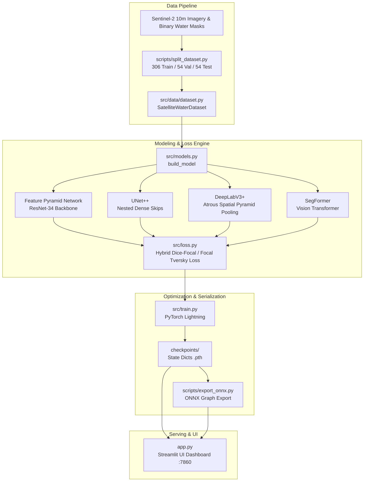

# GeoVision AI — Satellite Water Body Segmentation Platform

[](https://ai-geovision.streamlit.app/)
[](https://huggingface.co/safalya06/geovision-water-segmentation-models)
[](https://www.python.org/downloads/)
[](LICENSE)

A modular computer vision platform for high-resolution surface water detection, segmentation, and hydrological surface area quantification from optical satellite imagery (Sentinel-2).

* **Live Cloud Application**: [https://ai-geovision.streamlit.app/](https://ai-geovision.streamlit.app/)
* **Verified Checkpoints**: [`safalya06/geovision-water-segmentation-models@441a990`](https://huggingface.co/safalya06/geovision-water-segmentation-models)
* **Pinned Commit**: `441a99034b36336c34d86c23cfe9c1a8114ca3a4`
* **Champion Model (FPN-ResNet34)**: SHA-256 `d21fa18c36beabdb0b139364d347a6e97c1cc00e83e9ba92630e9a7795119eb1`

---

## 1. Problem Statement

Automated water body detection from optical remote sensing imagery is a critical capability for flood monitoring, reservoir storage tracking, and drought assessment. However, applying standard deep learning segmentation models directly to satellite tiles reveals fundamental technical challenges:

1. **Extreme Class Imbalance**: In optical satellite imagery, land dominates over surface water. In our Sentinel-2 benchmark dataset, water coverage across splits is: **3.89%** in train (306 tiles), **5.51%** in validation (54 tiles), and **13.38%** in the held-out test split (54 tiles), resulting in **4.13%** across the training/validation pool and **5.34%** overall across all 414 tiles (an overall 17.7:1 land-to-water ratio).
2. **The Accuracy Paradox**: Under severe imbalance, a trivial classifier predicting all background achieves **86.62% pixel accuracy** on the held-out test split (3,065,298 / 3,538,944 land pixels) while capturing **0.0% of genuine water bodies**, completely failing as a detection system.
3. **Fine-Boundary & Thin-Stream Degradation**: Standard segmentation decoders (such as ASPP in DeepLabV3+ or downsampled Transformer patches in SegFormer) lose narrow river tributaries and coastal boundaries through successive spatial pooling.

GeoVision AI evaluates multi-architecture segmentation models (**Feature Pyramid Networks (FPN)**, **UNet++**, **DeepLabV3+**, **SegFormer**), diagnoses systematic false negatives, and implements asymmetric recall-prioritized loss functions (**Tversky Loss** and **Focal Tversky Loss**) to achieve balanced precision and recall.

---

## 2. System Architecture



---

## 3. Verified Benchmark Results

All models were evaluated on the identical **54 held-out test patches** ($256 \times 256$, totaling **3,538,944 test pixels** containing 473,646 ground-truth water pixels and 3,065,298 land pixels). Evaluations were executed deterministically at frozen baseline threshold $\tau = 0.50$ (with validation-only calibrated threshold $\tau^* = 0.60$ tuned strictly on the 54 validation patches to assess threshold generalization).

| Model Architecture & Experiment | Model Class | Decision Threshold ($\tau$) | Pixel Accuracy (%) | Water Precision (%) | Water Recall (%) | Macro Dice | Macro IoU | Micro Dice | Micro IoU | True Positives (TP) | False Positives (FP) | False Negatives (FN) | True Negatives (TN) |
| :--- | :--- | :---: | :---: | :---: | :---: | :---: | :---: | :---: | :---: | :---: | :---: | :---: | :---: |
| **UNet++ (Exp1 Baseline)** | Baseline | 0.50 | 89.38% | 76.55% | 29.76% | 0.3032 | 0.2035 | 0.4285 | 0.2727 | 140,936 | 43,163 | 332,710 | 3,022,135 |
| **DeepLabV3+ (Exp2 Baseline)** | Baseline | 0.50 | 89.47% | 89.70% | 24.07% | 0.2211 | 0.1464 | 0.3795 | 0.2342 | 113,995 | 13,091 | 359,651 | 3,052,207 |
| **SegFormer-B0 (Exp3 Baseline)** | Baseline | 0.50 | 87.59% | 85.84% | 8.74% | 0.1083 | 0.0615 | 0.1586 | 0.0861 | 41,385 | 6,828 | 432,261 | 3,058,470 |
| **Improved UNet++ (EXP01 Tversky)** | Improved | 0.50 | 90.64% | 80.37% | 39.75% | 0.3872 | 0.2718 | 0.5319 | 0.3623 | 188,256 | 45,992 | 285,390 | 3,019,306 |
| **Improved DeepLabV3+ (EXP04 Focal Tversky)** | Improved | 0.50 | 90.22% | 78.57% | 37.05% | 0.3636 | 0.2542 | 0.5036 | 0.3365 | 175,501 | 47,872 | 298,145 | 3,017,426 |
| **Improved SegFormer-B0 (EXP05 Focal Tversky)** | Improved | 0.50 | 87.03% | 52.51% | 32.75% | 0.3414 | 0.2275 | 0.4034 | 0.2527 | 155,141 | 140,320 | 318,505 | 2,924,978 |
| **Improved FPN (EXP06 Focal Tversky) — CHAMPION** | **Champion** | **0.50** | **91.56%** | **75.81%** | **54.24%** | **0.4580** | **0.3328** | **0.6323** | **0.4624** | **256,886** | **81,954** | **216,760** | **2,983,344** |
| **Improved FPN (EXP06 Calibrated)** | Calibrated | 0.60 | 91.56% | 76.45% | 53.35% | 0.4544 | 0.3295 | 0.6284 | 0.4582 | 252,677 | 77,835 | 220,969 | 2,987,463 |

> [!NOTE]
> Detailed per-image breakdown, statistical distributions, and metric definitions are documented in [`reports/model-evaluation.md`](reports/model-evaluation.md) and [`reports/benchmark-results.csv`](reports/benchmark-results.csv).

---

## 4. Visual Evidence & Diagnostics

### Precision-Recall Curves
Precision-recall dynamics across decision thresholds ($0.10 \le \tau \le 0.90$). The champion FPN model maintains superior recall without steep precision degradation:


### Normalized Confusion Matrices
Pixel-level confusion matrices demonstrating the progressive reduction of false negative water pixels:


### Segmentation Sample (Patch 0010 — Inland Lake & Estuary)
Sample prediction illustrating high-fidelity shoreline extraction:


---

## 5. Technology Stack

## 5. Technology Stack

- **Machine Learning & Core**: PyTorch 2.x, PyTorch Lightning, Segmentation Models PyTorch (SMP), Transformers (Hugging Face).
- **Optimization & Runtime**: ONNX Runtime (CPU execution provider, Opset 18/14), onnxscript.
- **Frontend Dashboard**: Streamlit, PIL, Matplotlib, NumPy, Pandas.
- **Testing & Code Quality**: Pytest (136 unit, integration, model-registry, and input-validator tests).
- **Containerization & CI**: Docker, Docker Compose, GitHub Actions.

---

## 6. Installation & Quickstart

### Prerequisites
- Python 3.10 or 3.11
- Git

### Local Setup
```bash
# 1. Clone the repository
git clone https://github.com/safalyareddy/GEOVISION_AI.git
cd GEOVISION_AI

# 2. Create and activate a virtual environment
python3 -m venv venv
source venv/bin/activate

# 3. Install CPU PyTorch wheels and dependencies
pip install --upgrade pip
pip install torch torchvision --index-url https://download.pytorch.org/whl/cpu
pip install -r requirements.txt

# 4. Run the full automated test suite
PYTHONPATH=. pytest tests/ -v
```

---

## 7. Execution

### Launch Streamlit Interactive Dashboard
```bash
streamlit run app.py --server.port 8501
```
Navigate to `http://localhost:8501` to upload satellite tiles, switch inference engines (PyTorch vs ONNX Runtime), toggle architectures, tune the decision threshold slider, and compare model outputs.

*(Note: The legacy FastAPI microservice architecture has been retired. All inference, cryptographic checkpoint verification, and geospatial safety gating are now executed directly in-process via `src.inference`, `src.utils.model_registry`, and `src.utils.input_validator`).*

---

## 8. Docker & Cloud Deployment

### Run Containerized Streamlit Application (Hugging Face Spaces & Local Docker)
The root `Dockerfile` provides a containerized environment conforming to the **Hugging Face Docker Space SDK**:
- Non-root user execution (`UID 1000`, `appuser`).
- Native execution via `docker/entrypoint.sh` running Streamlit on public port `7860`.
- Cryptographic SHA-256 validation of model checkpoints with automatic Hugging Face Model Hub download.

```bash
# 1. Build production container
docker build -t geovision-ai:latest .

# 2. Run container (Streamlit UI exposed on port 7860)
docker run -p 7860:7860 geovision-ai:latest
```
Navigate to `http://localhost:7860` for the interactive dashboard.

### Run via Docker Compose
```bash
docker compose up -d --build
```
Navigate to `http://localhost:7860`.

---

## 9. Model Checkpoints & Cryptographic Verification
 
Model weights are saved as PyTorch state dictionaries (`.pth`). Checkpoint checksums and architectures are cataloged in `src/utils/model_registry.py` and pinned to Hugging Face Hub commit `441a99034b36336c34d86c23cfe9c1a8114ca3a4`:

| Architecture | Status | Checkpoint File | Size | SHA-256 Cryptographic Checksum |
| :--- | :--- | :--- | :---: | :--- |
| **FPN (Champion)** | 🏆 Champion | `fpn_best.pth` | 88.5 MB | `d21fa18c36beabdb0b139364d347a6e97c1cc00e83e9ba92630e9a7795119eb1` |
| **UNet++** | Production | `unet_plusplus_best.pth` | 99.7 MB | `497e246ef79d87f3b2255cc119e7ab8bd0045d48caf3d4710e9f6738e56c4548` |
| **DeepLabV3+** | Production | `deeplabv3_plus_best.pth` | 85.8 MB | `6c7c6dd4835d29be34b9eda03bdfca878914749a526c44cade99906cc1b1b827` |
| **SegFormer** | Production | `segformer_best.pth` | 14.3 MB | `2c762a52a5aa5cafb6aecb698bf483257fd5279bce3f3af7368850ba9354e986` |

### Multi-Engine Inference Support (8/8 Verified Combinations)
The platform supports two verified, production inference engines across all four models:

| Model Architecture | PyTorch (In-Process CPU) | ONNX Runtime (Accelerated CPU) | Parity Status (7 Test Tiles) |
| :--- | :---: | :---: | :---: |
| **FPN – ResNet34 (Champion)** | ✅ VERIFIED | ✅ VERIFIED | 100.0% Mask Agreement (Max \|Δp\|: 1.69e-5) |
| **UNet++ – ResNet34** | ✅ VERIFIED | ✅ VERIFIED | 100.0% Mask Agreement (Max \|Δp\|: 3.18e-5) |
| **DeepLabV3+ – ResNet34** | ✅ VERIFIED | ✅ VERIFIED | 100.0% Mask Agreement (Max \|Δp\|: 1.39e-5) |
| **SegFormer – MiT-B0** | ✅ VERIFIED | ✅ VERIFIED | 100.0% Mask Agreement (Max \|Δp\|: 1.73e-6) |

1. **PyTorch Engine (In-Process CPU/MPS)**: Evaluates loaded models using `torch.inference_mode()` with strict state dictionary loading and SHA-256 verification.
2. **ONNX Runtime Engine (Accelerated CPU)**: Standalone Open Neural Network Exchange graph execution with full operator parity and CPU graph optimizations.

### Scientific Safety & Input Validation Pipeline
GeoVision AI implements a 6-state input verification engine (`src/utils/input_validator.py`):
1. **Consumer Photograph Rejection**: Scans for smartphone/consumer camera EXIF metadata and detects extreme chromatic saturation ($>35\%$ of pixels with $S > 0.80$). Rejects floral/portrait/indoor photos with explicit UI safety alerts to prevent unscientific hydrological claims.
2. **Two-Mode Area Quantification**:
   - **Verified Geospatial Mode**: Reads embedded GeoTIFF tags (`ModelPixelScaleTag`) to calculate exact square kilometers based on physical coordinate bounds.
   - **Nominal Approximation Mode**: Applies calibrated Sentinel-2 10m Ground Sample Distance assumption ($100.0\text{ m}^2/\text{pixel}$) accompanied by an explicit unreferenced approximation caveat.
3. **Zero-Uninitialized Policy**: Strictly disallows inference with random, fallback, or unverified weights.

---

## 10. Limitations & Engineering Scope

1. **Geographic Distribution**: The benchmark dataset consists of regional Sentinel-2 optical scenes. Universal generalization is not claimed without regional fine-tuning across unseen geographic domains.
2. **Optical Sensor Constraints**: Cloud cover, dense haze, and sun glint impede optical surface reflectance. Operational remote sensing in production typically pairs optical imagery with Synthetic Aperture Radar (SAR, Sentinel-1) or multi-spectral indices (MNDWI).
3. **Physical Area Estimation**: The computed water surface area ($\text{km}^2$) uses nominal Sentinel-2 10m Ground Sample Distance ($100 \text{ m}^2/\text{pixel}$) unless input imagery contains embedded GeoTIFF pixel scale tags.

---

## 11. License

This project is licensed under the [MIT License](LICENSE).

