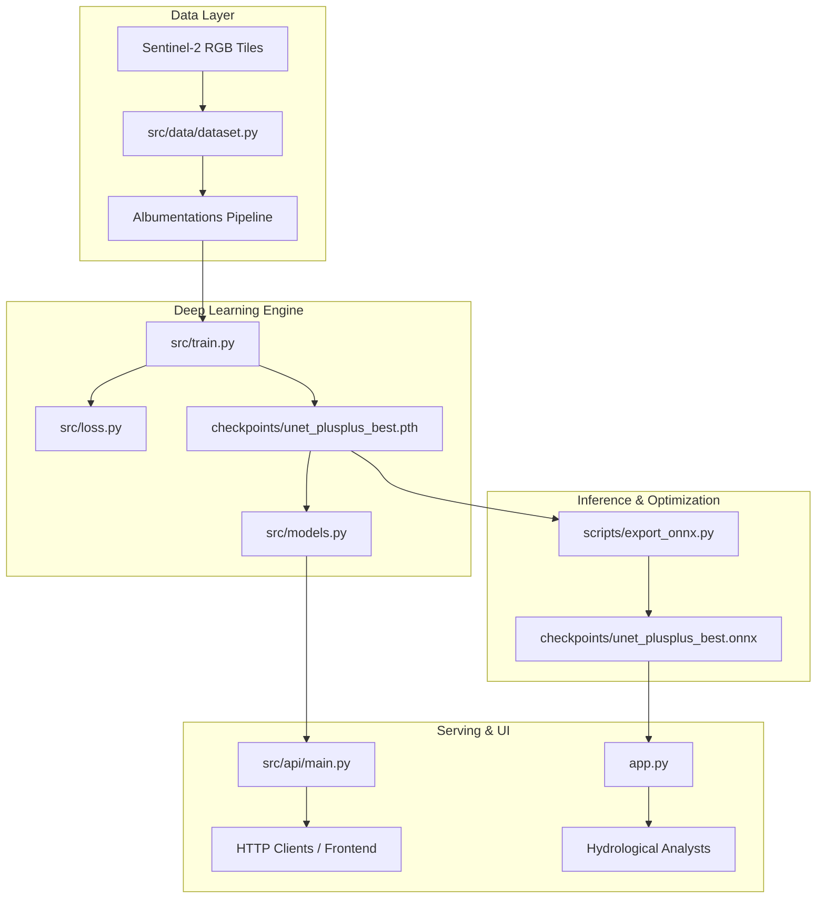

# GeoVision AI — System Architecture & Design

GeoVision AI is a modular deep learning platform designed for surface water body detection and segmentation from optical satellite imagery.

---

## 1. High-Level System Architecture

---

## 2. Core Subsystems

### A. Data Ingestion & Transformation (`src/data/dataset.py`)
* Implements PyTorch `Dataset` with deterministic train/val/test splits.
* Features Albumentations augmentation pipeline: Random crop, horizontal flip, vertical flip, random rotate90, and z-score normalization ($256 \times 256 \times 3$).

### B. Segmentation Models (`src/models.py`)
* Unified factory `build_model(model_name)` supporting:
  * **UNet++**: Nested skip pathways with deep supervision (`smp.UnetPlusPlus`, ResNet-34).
  * **DeepLabV3+**: Atrous Spatial Pyramid Pooling with depthwise separable convolutions (`smp.DeepLabV3Plus`, ResNet-34).
  * **SegFormer**: Lightweight hierarchical Vision Transformer (`nvidia/mit-b2` via HuggingFace `SegformerForSemanticSegmentation`).

### C. Objective Function (`src/loss.py`)
* Convex combination of Soft Dice Loss and Binary Focal Loss ($\alpha=0.25, \gamma=2.0$).
* Formulated to handle extreme 5.34% water vs 94.66% land class imbalance.

### D. Serving Interfaces
* **FastAPI Microservice** (`src/api/main.py`): RESTful endpoints with chunked streaming size limits, input verification, and base64 encoded binary mask responses.
* **Streamlit Dashboard** (`app.py`): Multi-model interactive visual comparison with real-time threshold slider and hydrological surface area calculations.
