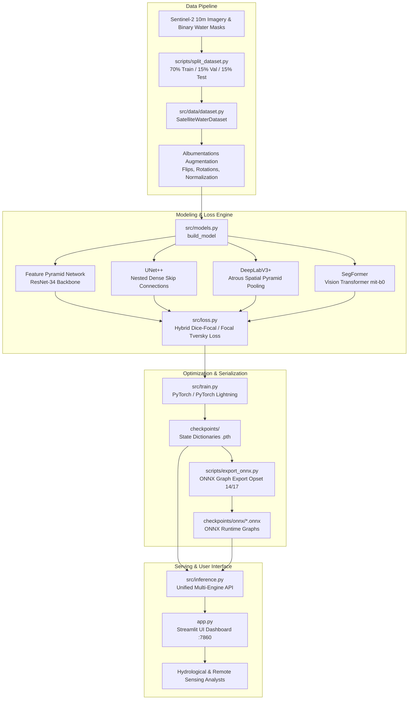

# GeoVision AI — System Architecture & Data Flow

GeoVision AI is a modular, high-performance deep learning and computer vision platform designed for satellite surface water body detection, segmentation, and hydrological surface area quantification from optical imagery (Sentinel-2).

---

## 1. End-to-End System Architecture

---

## 2. Core Architectural Subsystems

### A. Data Layer (`src/data/dataset.py`, `scripts/split_dataset.py`)
- **Dataset Structure**: Sentinel-2 optical RGB tiles ($256 \times 256$) paired with binary ground-truth water masks ($0 = \text{Land/Background}, 255 = \text{Water}$).
- **Partitioning**: Strictly partitioned into 306 training tiles (70%), 54 validation tiles (15%), and 54 held-out test tiles (15%) with zero spatial or temporal leakage.
- **Loading & Preprocessing**: `SatelliteWaterDataset` provides standard PyTorch `Dataset` interfaces with verified 1-to-1 pair indexing, channel reordering $(C, H, W)$, and normalization.

### B. Model Layer (`src/models.py`)
The factory method `build_model(model_name)` constructs production-grade segmentation networks:
1. **Feature Pyramid Network (FPN)**: ResNet-34 backbone with top-down pathway and lateral connections ($P_2$ through $P_5$), optimized for capturing fine-scale water bodies and narrow channels.
2. **UNet++**: Nested dense skip pathways connecting encoder and decoder sub-networks, reducing the semantic gap between feature maps.
3. **DeepLabV3+**: Combines Atrous Spatial Pyramid Pooling (ASPP) with depthwise separable convolutions to capture multi-scale context without resolution loss.
4. **SegFormer**: Lightweight hierarchical Vision Transformer using overlapping patch embeddings and multi-layer perceptron (MLP) decoders.

### C. Objective Functions (`src/loss.py`)
To handle severe class imbalance (overall 5.34% water vs. 94.66% land; 3.89% in train split), the platform implements:
- **Soft Dice Loss**: Measures region overlap directly, preventing gradient vanishing on small targets.
- **Focal Loss**: Dynamically down-weights easy background examples $(\gamma=2.0, \alpha=0.25)$ to focus backpropagation on ambiguous boundaries.
- **Tversky & Focal Tversky Loss**: Asymmetrically penalizes False Negatives ($\beta=0.7 > \alpha=0.3$) with focusing exponent $\gamma=1.33$ to recover missed water bodies.

### D. Serving Interfaces & Execution Backends
1. **Streamlit Interactive Dashboard** (`app.py`):
   - Production web application running on port `7860` (Hugging Face Spaces and cloud compatible).
   - In-process multi-engine selector: **PyTorch (In-Process CPU/MPS)** and **ONNX Runtime (Accelerated CPU)**.
   - Interactive threshold tuning slider ($0.10 \le \tau \le 0.90$).
   - Multi-model simultaneous comparison mode across all 4 architectures.
   - Cyan water-overlay visualization and side-by-side ground truth comparison.
2. **Unified Inference Pipeline** (`src/inference.py`):
   - Decoupled functional Python API exposing `predict`, `predict_onnx`, `predict_all`, `load_model`, and `load_onnx_session`.
   - Automatic ONNX fallback export (`dynamo=False`, opset 14/17) when pre-exported graphs are not present.
   - Dynamic caching of models and sessions in memory.
3. **Container Supervisor** (`docker/entrypoint.sh`):
   - Single-service container lifecycle management conforming to Hugging Face Spaces Docker SDK.
   - Runs under non-root unprivileged user `appuser` (`UID 1000`).
   - Clean signal trapping (SIGTERM, SIGINT) and healthcheck endpoint (`/_stcore/health`).
4. **Retired FastAPI Microservice** (`src/api/main.py`):
   - *Architecture Notice*: The FastAPI microservice has been completely retired from active serving to eliminate unnecessary HTTP serialization overhead, proxy hops, and multi-process server dependencies.

### E. Model Registry & Verification Engine (`src/utils/model_registry.py`)
- Cryptographic SHA-256 verification before state dict deserialization.
- Local candidate search with fallback to automated Hugging Face Model Hub download.
- Pinned to authoritative Hugging Face Hub commit `441a99034b36336c34d86c23cfe9c1a8114ca3a4`.
- Strict prevention of uninitialized execution (halts with diagnostic if weights cannot be verified).

---

## 3. Data Flow

1. **Ingestion & Input Validation**: The client uploads an optical satellite image via the Streamlit interface. The file is validated by `src/utils/input_validator.py` (checking magic bytes, rejecting consumer camera EXIF metadata, and detecting extreme non-satellite saturation).
2. **Tensor Preprocessing**: Resized to $256 \times 256$, normalized to $[0.0, 1.0]$ float32 tensor across all architectures, shaped as $(1, 3, 256, 256)$.
3. **Inference**: Propagated through the selected network and engine:
   - **PyTorch**: Native forward pass inside `torch.inference_mode()`.
   - **ONNX Runtime**: Graph session execution via optimized CPU provider.
4. **Activation**: Raw output logits are converted to class probabilities via the sigmoid function $\sigma(z) = \frac{1}{1 + e^{-z}}$.
5. **Thresholding & Postprocessing**: Evaluated against decision threshold $\tau$:
   $$\hat{Y}_{i,j} = \begin{cases} 1 & \text{if } P(Y_{i,j} = 1 \mid X) \ge \tau \\ 0 & \text{otherwise} \end{cases}$$
6. **Quantification**: Computes pixel-level water coverage fraction and physical area approximation:
   - **Verified Geospatial Mode**: If GeoTIFF pixel scale tags are present, calculates exact metric surface area from physical coordinates.
   - **Nominal Mode**: Assumes Sentinel-2 10m Ground Sample Distance (GSD, $100.0\text{ m}^2/\text{pixel}$) accompanied by an explicit unreferenced approximation disclaimer.
7. **Visualization**: Renders cyan overlay masks, telemetry metrics (water %, area $\text{km}^2$, latency $\text{ms}$), and side-by-side comparative views.
