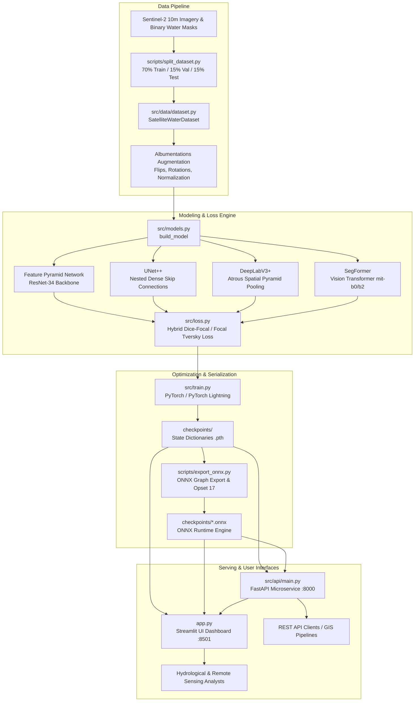

# GeoVision AI — System Architecture & Data Flow

GeoVision AI is a modular, high-performance deep learning and computer vision platform designed for satellite surface water body detection, segmentation, and hydrological surface area quantification from optical imagery (Sentinel-2).

---

## 1. End-to-End System Architecture

---

## 2. Core Architectural Subsystems

### A. Data Layer (`src/data/dataset.py`, `scripts/split_dataset.py`)
- **Dataset Structure**: Sentinel-2 optical RGB tiles ($256 \times 256$) paired with binary ground-truth water masks ($0 = \text{Land/Background}, 255 = \text{Water}$).
- **Partitioning**: Strictly partitioned into 306 training tiles (70%), 54 validation tiles (15%), and 54 held-out test tiles (15%) with zero spatial or temporal leakage.
- **Loading & Preprocessing**: `SatelliteWaterDataset` provides standard PyTorch `Dataset` interfaces with verified 1-to-1 pair indexing, channel reordering $(C, H, W)$, and normalization.

### B. Model Layer (`src/models.py`)
The factory method `build_model(model_name)` constructs production-grade segmentation networks:
1. **Feature Pyramid Network (FPN)**: ResNet-34 backbone with top-down pathway and lateral connections ($P_2$ through $P_5$), optimized for capturing fine-scale water bodies and narrow channels.
2. **UNet++**: Nested dense skip pathways connecting encoder and decoder sub-networks, reducing the semantic gap between feature maps.
3. **DeepLabV3+**: Combines Atrous Spatial Pyramid Pooling (ASPP) with depthwise separable convolutions to capture multi-scale context without resolution loss.
4. **SegFormer**: Lightweight hierarchical Vision Transformer using overlapping patch embeddings and multi-layer perceptron (MLP) decoders.

### C. Objective Functions (`src/loss.py`)
To handle severe class imbalance (overall 5.34% water vs. 94.66% land; 3.89% in train split), the platform implements:
- **Soft Dice Loss**: Measures region overlap directly, preventing gradient vanishing on small targets.
- **Focal Loss**: Dynamically down-weights easy background examples $(\gamma=2.0, \alpha=0.25)$ to focus backpropagation on ambiguous boundaries.
- **Tversky & Focal Tversky Loss**: Asymmetrically penalizes False Negatives ($\beta=0.7 > \alpha=0.3$) with focusing exponent $\gamma=1.33$ to recover missed water bodies.

### D. Serving Interfaces
1. **FastAPI Microservice** (`src/api/main.py`):
   - High-throughput asynchronous REST API exposing `/health`, `/models`, and `/predict`.
   - Streaming multipart file verification with 10 MB payload limits and format sanitization.
   - Dynamic checkpoint caching on CPU/MPS/CUDA.
   - Returns predicted water coverage percentage, nominal area ($\text{km}^2$), latency ($\text{ms}$), and base64-encoded PNG masks.
2. **Streamlit Interactive Dashboard** (`app.py`):
   - Multi-backend execution: FastAPI REST API, in-process PyTorch, or in-process ONNX Runtime.
   - Interactive threshold tuning slider ($0.10 \le \tau \le 0.90$).
   - Cyan water-overlay visualization and side-by-side ground truth comparison.
3. **Container Supervisor** (`docker/entrypoint.sh`):
   - Dual-service process supervision conforming to Hugging Face Spaces Docker SDK.
   - Binds Streamlit to public port `7860` and FastAPI to internal port `8000`.
   - Non-root user execution (`UID 1000`) and graceful SIGTERM signal handling.

### E. Model Registry & Verification Engine (`src/utils/model_registry.py`)
- Cryptographic SHA-256 verification before state dict deserialization.
- Local candidate search with fallback to automated Hugging Face Model Hub download.
- Strict prevention of uninitialized execution (HTTP 503 error if weights are missing).

---

## 3. Data Flow

1. **Ingestion**: The client posts an optical satellite image file to `/predict` or uploads it via the Streamlit interface.
2. **Validation**: The image format is verified (PNG/JPG/TIFF), payload size verified ($\le 10 \text{MB}$), and decoded to RGB.
3. **Tensor Preprocessing**: Resized to $256 \times 256$, normalized to $[0, 1]$ float32 tensor across all architectures, shaped as $(1, 3, 256, 256)$.
4. **Inference**: Propagated through the selected network in evaluation mode (`torch.no_grad()`). Raw output logits are converted to class probabilities via the sigmoid function $\sigma(z) = \frac{1}{1 + e^{-z}}$.
5. **Thresholding & Postprocessing**: Evaluated against decision threshold $\tau$:
   $$\hat{Y}_{i,j} = \begin{cases} 1 & \text{if } P(Y_{i,j} = 1 \mid X) \ge \tau \\ 0 & \text{otherwise} \end{cases}$$
6. **Quantification**: Computes pixel-level water coverage fraction and physical area approximation assuming Sentinel-2 10m Ground Sample Distance (GSD):
   $$\text{Coverage (\%)} = \frac{\sum \hat{Y}_{i,j}}{H \times W} \times 100, \quad \text{Area } (\text{km}^2) = \frac{\sum \hat{Y}_{i,j} \times 100 \text{ m}^2}{10^6 \text{ m}^2/\text{km}^2}$$
7. **Response Delivery**: Returns structured JSON metadata with base64 PNG mask string or renders interactive overlay on the UI.
