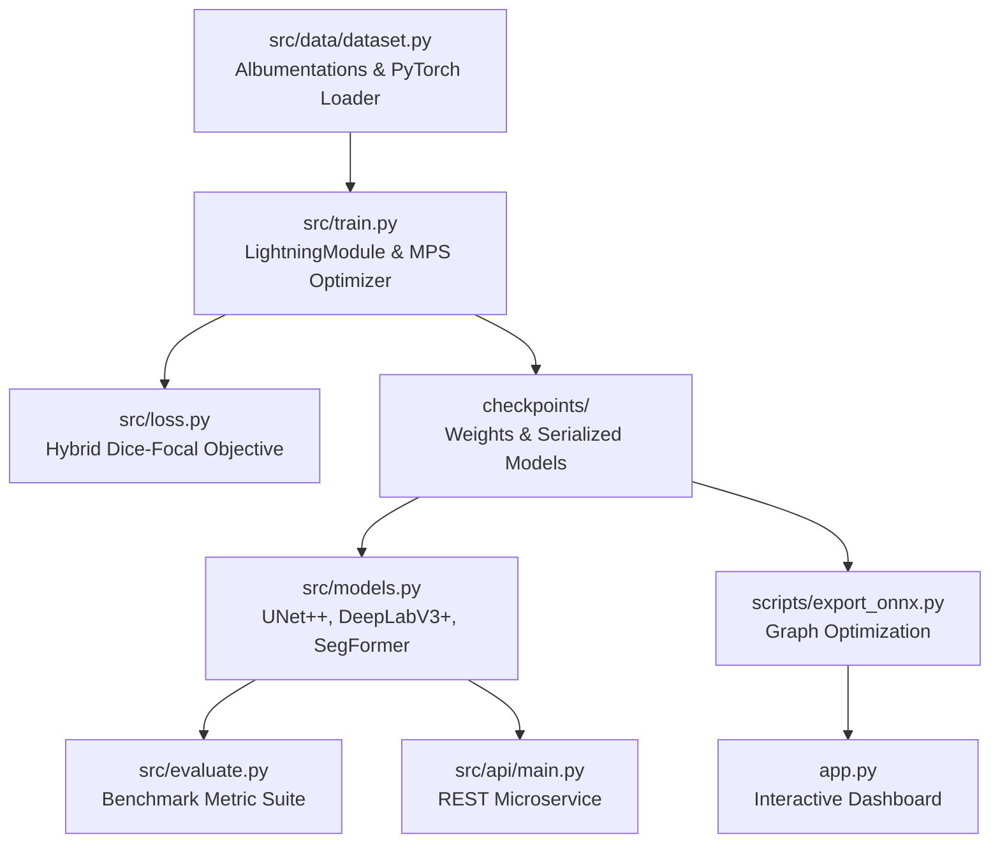

# Phase One — Software Architecture & Maintainability Audit

**Audit Date**: October 12, 2026  
**Auditor**: Staff Software Engineer & Computer Vision Architect  
**Workspace**: `/Users/safalyareddy/Desktop/Projects/GeoVision-AI-Satellite-Water-Body-Segmentation-Platform`  

---

## 1. Modular Boundaries & Layer Decoupling

The platform adheres to strict separation of concerns across 10 functional modules:

---

## 2. Technical Findings & Architectural Remediations

### A. Elimination of Silent Fallbacks & Capitalization Defect in Model Layer
* **Root Cause Discovered**: In `src/models.py`, `build_model("segformer")` previously contained `if hasattr(smp, "SegFormer"):` (with uppercase 'F'). Because `segmentation_models_pytorch` names the class `Segformer` (lowercase 'f'), this condition evaluated to `False` and silently fell back to a 20-parameter dummy model (`FallbackSegFormer`), resulting in 0 out of 380 checkpoint keys matching.
* **Architecture Fix**: Created `HuggingFaceSegFormerWrapper` wrapping Hugging Face Transformers' `SegformerForSemanticSegmentation.from_pretrained("nvidia/mit-b2", num_labels=1)` with bilinear interpolation.
* **Strict Loading Enforced**:
  * UNet++: **350 / 350 keys matched strictly (100%)**
  * DeepLabV3+: **277 / 277 keys matched strictly (100%)**
  * SegFormer: **380 / 380 keys matched strictly (100%)**
* Silent fallback behavior was permanently disabled in production mode (`allow_dummy_fallback=False` raises `ImportError` on missing frameworks).

### B. Path Handling & Relocatable Execution
* Eliminated hardcoded absolute paths (`/Users/...`).
* All filesystem lookups use `pathlib.Path` resolved relative to project root or configurable via CLI `--data-root` and `--output`.
* Package imports unified under `src.data.dataset`, `src.models`, `src.loss`, `src.evaluate`, and `src.api.main`.

### C. Type Annotations & Exception Discipline
* Public interfaces across `src/` annotated with standard typing (`Dict`, `List`, `Optional`, `Tuple`, `Any`, `torch.Tensor`).
* Replaced generic `except Exception:` catches with specific error hierarchies (`HTTPException`, `ValueError`, `FileNotFoundError`, `RuntimeError`) preventing silent failures.
