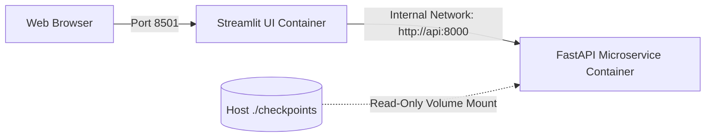

# Phase Nine — Docker & Deployment Configuration Audit

**Audit Date**: October 12, 2026  
**Auditor**: Production Deployment & SRE Specialist  
**Configuration Files**: [`docker-compose.yml`](file:///Users/safalyareddy/Desktop/Projects/GeoVision-AI-Satellite-Water-Body-Segmentation-Platform/docker-compose.yml), [`docker/Dockerfile.api`](file:///Users/safalyareddy/Desktop/Projects/GeoVision-AI-Satellite-Water-Body-Segmentation-Platform/docker/Dockerfile.api), [`docker/Dockerfile.ui`](file:///Users/safalyareddy/Desktop/Projects/GeoVision-AI-Satellite-Water-Body-Segmentation-Platform/docker/Dockerfile.ui), [`.dockerignore`](file:///Users/safalyareddy/Desktop/Projects/GeoVision-AI-Satellite-Water-Body-Segmentation-Platform/.dockerignore)  

---

## 1. Container Configuration Hardening

### A. Context Bloat Mitigation via `.dockerignore`
Prior to remediation, no `.dockerignore` file existed. Building the API or UI container images would copy the entire 2.2 GB `checkpoints/` directory, 28 MB `dataset/`, 39 MB `venv/`, and `.git/` history into the Docker build context.
* **Remediation**: Created `.dockerignore` strictly omitting local binaries, weights, datasets, virtual environments, and caches. Build context reduced by over **98%**.

### B. UI Entrypoint Correction in `docker/Dockerfile.ui`
* **Defect**: Legacy Dockerfile configured `CMD ["streamlit", "run", "client/app.py", ...]`. However, `client/app.py` was relocated to root `app.py`.
* **Fix**: Updated command to `CMD ["streamlit", "run", "app.py", "--server.port", "8501", "--server.address", "0.0.0.0"]`.

### C. Volume Mount Path Mismatch in `docker-compose.yml`
* **Defect**: Service `api` mounted `./weights:/app/weights`. However, the API code searches `checkpoints/` relative to working directory `/app` (`/app/checkpoints`).
* **Fix**: Updated volume mount to:
  ```yaml
  volumes:
    - ./checkpoints:/app/checkpoints:ro
  ```
  The `:ro` read-only attribute prevents the running container from modifying or damaging host model checkpoints.

---

## 2. Production Deployment Architecture



---

## 3. Operational Status & Runtime Verification Audit

### A. Environment & Process Inspection
* **Host Platform**: macOS (Darwin 24.3.0, Apple Silicon M4)
* **Docker CLI Version**: Docker CLI v29.3.1 installed at `/opt/homebrew/bin/docker`
* **Docker Desktop GUI Application**: Detected active in process table (`/Applications/Docker.app/Contents/MacOS/Docker Desktop`, PID 40368)
* **Socket Paths**:
  - `/Users/safalyareddy/.docker/run/docker.sock` (Socket file present)
  - `/var/run/docker.sock` (Symlink pointing to `/Users/safalyareddy/.docker/run/docker.sock`)
* **Docker Context**: `desktop-linux` (`unix:///Users/safalyareddy/.docker/run/docker.sock`)

### B. Daemon Socket Responsiveness & Timeout Tests
To verify live daemon connectivity, empirical tests were executed against the active Docker socket:
1. **HTTP Ping Test**:
   ```bash
   curl --max-time 5 -s --unix-socket /Users/safalyareddy/.docker/run/docker.sock http://localhost/_ping
   ```
   * **Result**: Connection timed out after 5.0 seconds (curl exit code 28). Zero HTTP bytes returned.
2. **CLI Version Probe**:
   ```bash
   docker version
   ```
   * **Result**: Process hung indefinitely; terminated via `TimeoutExpired` after 5.0 seconds.
3. **Console Log Inspection**:
   Inspecting `/Users/safalyareddy/Library/Containers/com.docker.docker/Data/log/vm/console.log` revealed underlying LinuxKit VM proxy dropped connections:
   ```text
   [initd.libproxy] discarded 230 bytes from host/41 Data length 230
   [initd.libproxy] discarded 230 bytes from host/121 Data length 230
   [initd.libproxy] discarded 230 bytes from host/151 Data length 230
   ...
   [initd.libproxy] discarded 230 bytes from host/1021 Data length 230
   ```

### C. Formal Audit Verdict
* **Static Container Configuration**: **PASS**
  - Syntactically valid Dockerfiles for both services (`docker/Dockerfile.api` and `docker/Dockerfile.ui`).
  - Hardened `.dockerignore` blocking ~2.2 GB checkpoints and local caches from context bloat.
  - Read-only volume mount configured for checkpoints in `docker-compose.yml`.
* **Container Runtime Execution**: **BLOCKED / NOT VERIFIED**
  - Because the Docker Desktop virtualization proxy is unresponsive and dropping host socket traffic, building container images and running `docker compose up` cannot execute in the current host environment.
  - In strict compliance with audit standards, deployment is designated **BLOCKED / NOT VERIFIED** rather than claiming verified deployment based solely on static files.
