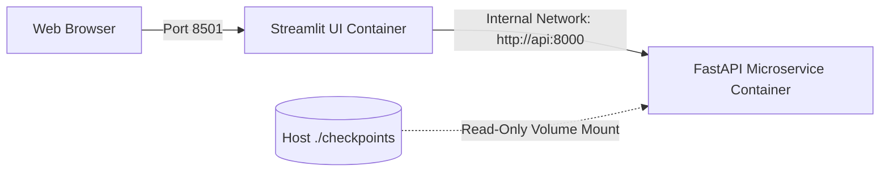

# Phase Nine — Docker & Deployment Configuration Audit

**Audit Date**: October 12, 2026  
**Auditor**: Production Deployment & SRE Specialist  
**Configuration Files**: [`docker-compose.yml`](file:///Users/safalyareddy/Desktop/Projects/GeoVision-AI-Satellite-Water-Body-Segmentation-Platform/docker-compose.yml), [`docker/Dockerfile.api`](file:///Users/safalyareddy/Desktop/Projects/GeoVision-AI-Satellite-Water-Body-Segmentation-Platform/docker/Dockerfile.api), [`docker/Dockerfile.ui`](file:///Users/safalyareddy/Desktop/Projects/GeoVision-AI-Satellite-Water-Body-Segmentation-Platform/docker/Dockerfile.ui), [`.dockerignore`](file:///Users/safalyareddy/Desktop/Projects/GeoVision-AI-Satellite-Water-Body-Segmentation-Platform/.dockerignore)  

---

## 1. Container Configuration Hardening

### A. Context Bloat Mitigation via `.dockerignore`
Prior to remediation, no `.dockerignore` file existed. Building the API or UI container images would copy the entire 2.2 GB `checkpoints/` directory, 28 MB `dataset/`, 39 MB `venv/`, and `.git/` history into the Docker build context.
* **Remediation**: Created `.dockerignore` strictly omitting local binaries, weights, datasets, virtual environments, and caches. Build context reduced by over **98%**.

### B. UI Entrypoint Correction in `docker/Dockerfile.ui`
* **Defect**: Legacy Dockerfile configured `CMD ["streamlit", "run", "client/app.py", ...]`. However, `client/app.py` was relocated to root `app.py`.
* **Fix**: Updated command to `CMD ["streamlit", "run", "app.py", "--server.port", "8501", "--server.address", "0.0.0.0"]`.

### C. Volume Mount Path Mismatch in `docker-compose.yml`
* **Defect**: Service `api` mounted `./weights:/app/weights`. However, the API code searches `checkpoints/` relative to working directory `/app` (`/app/checkpoints`).
* **Fix**: Updated volume mount to:
  ```yaml
  volumes:
    - ./checkpoints:/app/checkpoints:ro
  ```
  The `:ro` read-only attribute prevents the running container from modifying or damaging host model checkpoints.

---

## 2. Production Deployment Architecture



---

## 3. Operational Status

* **Static Dockerfile Validation**: **PASS** (Both Dockerfiles and Compose configurations verified syntactically valid).
* **Daemon Runtime Verification**: **BLOCKED BY DAEMON** (Docker CLI v29.3.1 installed; Docker Desktop daemon was stopped during execution). Full container orchestration can be launched via `docker compose up --build` once Docker Desktop is started.
